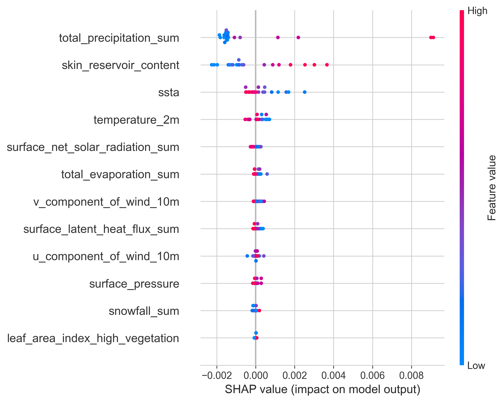
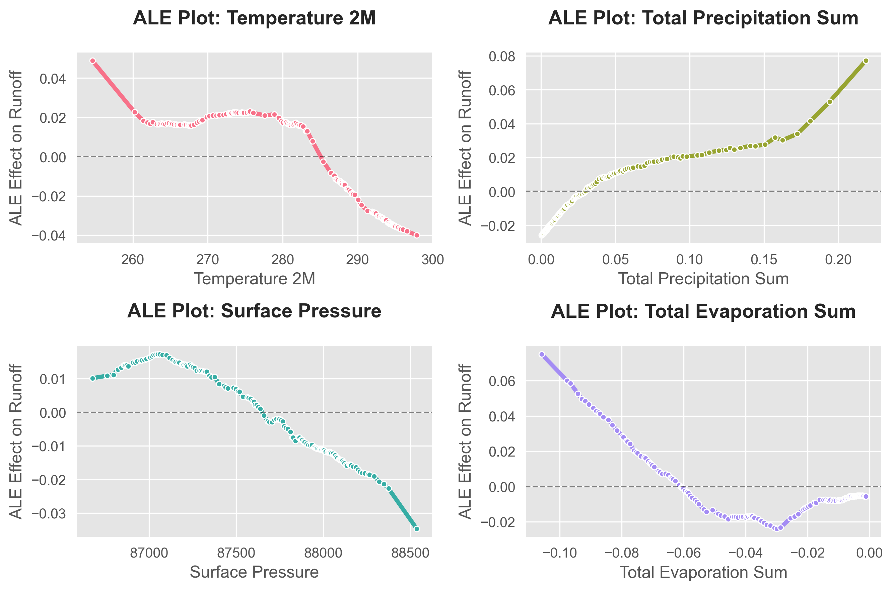
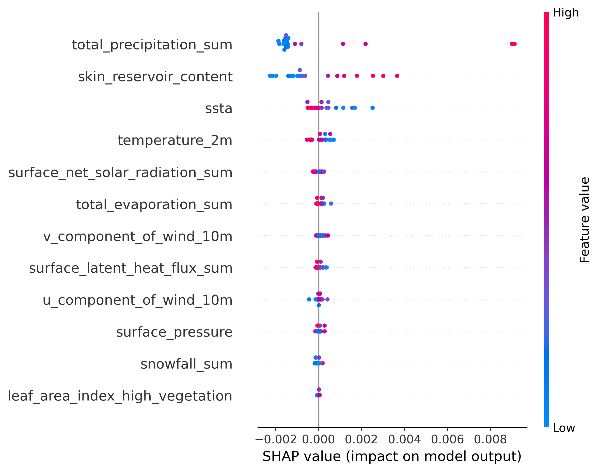

# ALIBI_explain

用 SHAP 和累积局部效应（ALE）分析径流预测模型的特征贡献。项目包含两条可独立运行的流程：随机森林 + SHAP，以及多层感知机 + ALIBI ALE。

## 结果展示

以下为项目已保存的结果图，尚未在本轮重新运行验证。

| SHAP 特征贡献 | ALE 响应曲线 |
| --- | --- |
|  |  |

## 运行

在项目根目录准备 `geo.csv`。脚本将 `runoff_sum` 作为预测目标，排除 `time` 列，其余列作为输入特征。

```bash
python -m pip install pandas numpy matplotlib seaborn scikit-learn shap alibi
python code/runoff_prediction_shap.py
python code/runoff_prediction_ale.py
```

Notebook 入口为 [`alibi_cookbook.ipynb`](alibi_cookbook.ipynb)。依赖列表依据源码导入整理，当前项目没有固定依赖版本的环境文件。

## 文件

| 入口 | 用途 |
| --- | --- |
| `code/runoff_prediction_shap.py` | 训练随机森林，输出 SHAP 汇总图和重要性图 |
| `code/runoff_prediction_ale.py` | 训练 MLP，输出 ALE 曲线和效应幅度图 |
| `geo.csv` | 本地径流及环境变量输入 |
| `figure/` | 保存绘图结果 |
| `docs_EN.md` | 项目已有英文资料 |

SHAP 和 ALE 描述模型对输入特征的响应，不能单凭这些图把相关性解释为因果效应。跨时间或跨流域使用前，应另行设计验证划分。

条幅源文件：[Excalidraw](assets/readme/banner.excalidraw)。


<!-- readme-visual-refresh:remote-result -->
## Reproduced on EHPC · 17 October 2026



Random-forest runoff model: SHAP feature contributions. Generated by the original project script in an isolated PBS CPU job; source and input hashes, package versions, and exit status are recorded in the [run record](assets/readme/remote-run.json). This run demonstrates execution on the supplied dataset; it does not establish independent generalization or causal effects.
<!-- /readme-visual-refresh:remote-result -->
